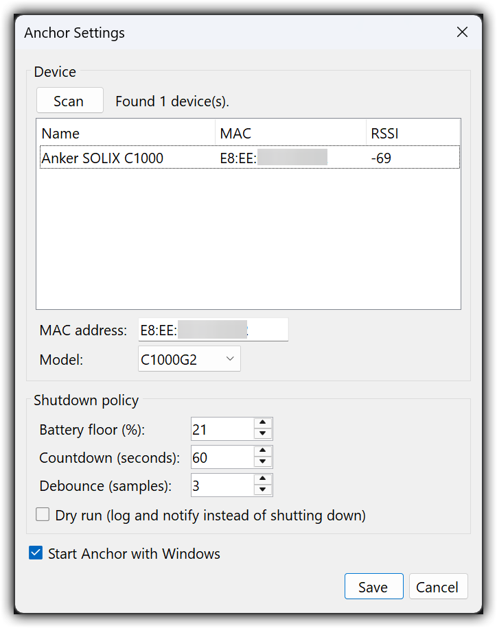
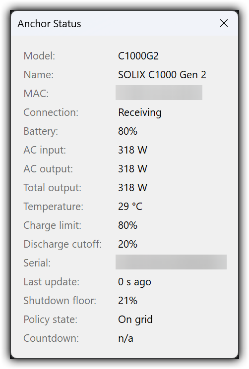

# Anchor

Anchor turns your Anker Solix power station into a UPS for your PC. It runs on Windows and on Linux with KDE Plasma. It sits in your system tray, talks to the power station over Bluetooth, and shuts your computer down gracefully when the power goes out and the battery gets low.

If you've ever wished PowerChute worked without a special cable or a dedicated UPS box, this is that. Your power station is already running your PC. Anchor just watches the battery and handles the shutdown so you don't lose work.

## Screenshots





## What it does

Anchor connects to your power station over Bluetooth and watches two things: whether wall power is plugged in, and what the battery level is.

When you lose wall power and the battery drops to your chosen floor (say, 15%), Anchor starts a countdown. If the power comes back during the countdown, it cancels. If not, it shuts your computer down cleanly. On KDE, Anchor asks Plasma to log out and shut down, the same as picking Shut Down from the menu, so apps with unsaved work get to ask you first.

There's a dry run mode if you want to test your settings without actually shutting down. It runs through all the same logic but just logs what it would have done. After a dry run triggers, Anchor waits until it sees wall power return before arming for another outage.

## Which models work

The C1000X and C1000 Gen 2 are tested and working. The C300, C800, F2000, F2600, and F3800 should also work but I haven't personally tested them. Pick C1000G2 for a C1000 Plus or C1000X Gen 2, and F3800 for an F3800 Plus.

Other Anker stuff (Solarbank, PowerCore chargers, power banks) won't work. They either don't broadcast the data Anchor needs or don't make sense as a PC backup.

## Install

Your PC needs Bluetooth, and it needs to be close enough to the power station for Bluetooth to reach.

### Windows

Download the latest installer from the releases page and run it. It needs admin rights to install to Program Files.

Windows will probably complain because the installer isn't signed. Click "More info" then "Run anyway" to get past SmartScreen.

### Linux

Anchor is built for KDE Plasma 6 on x64. Other desktops with a system tray may work, but I don't test them. GNOME has no tray unless you install the AppIndicator extension.

Add the package repo for your distro, so updates come through your package manager like any other app.

On Kubuntu, Debian, or Ubuntu (updates also show in Discover):

```sh
sudo install -d -m 0755 /etc/apt/keyrings
sudo curl -fsSL https://telesphorepo.com/debian/debian/key.asc -o /etc/apt/keyrings/telesphorepo.asc
echo "deb [signed-by=/etc/apt/keyrings/telesphorepo.asc] https://telesphorepo.com/debian/debian stable main" \
  | sudo tee /etc/apt/sources.list.d/telesphorepo.list
sudo apt update
sudo apt install anchor
```

On CachyOS or Arch:

```sh
curl -fsSL https://telesphorepo.com/arch/arch/key.asc -o /tmp/telesphorepo.asc
sudo pacman-key --add /tmp/telesphorepo.asc
sudo pacman-key --lsign-key "$(gpg --with-colons --show-keys /tmp/telesphorepo.asc | awk -F: '/^fpr/ {print $10; exit}')"
printf '\n[arch]\nSigLevel = Required\nServer = https://telesphorepo.com/arch/$repo/$arch\n' | sudo tee -a /etc/pacman.conf
sudo pacman -Sy anchor
```

The section must be named `[arch]`, the name of the repo in the server address.

On Fedora:

```sh
sudo rpm --import https://telesphorepo.com/rpm/rpm/key.asc
printf '[telesphorepo]\nname=Telesphorepo\nbaseurl=https://telesphorepo.com/rpm/rpm/\ngpgcheck=1\nrepo_gpgcheck=1\ngpgkey=https://telesphorepo.com/rpm/rpm/key.asc\nmetadata_expire=1h\n' \
  | sudo tee /etc/yum.repos.d/telesphorepo.repo
sudo dnf install anchor
```

The releases page also has a package for each distro family. Download the one for yours and install it:

```sh
sudo apt install ./anchor_<version>-1_amd64.deb             # Kubuntu, Debian, Ubuntu
sudo pacman -U anchor-<version>-1-x86_64.pkg.tar.zst        # CachyOS, Arch
sudo dnf install ./anchor-<version>-1.x86_64.rpm            # Fedora
```

The package pulls in BlueZ and the libraries Anchor needs. Open Anchor from the application menu, or run `anchor`.

### Checking a download

If you want to check that your download really came from this repo's build pipeline, every release ships with a SHA256SUMS.txt file and a signed provenance attestation for each file. With the [GitHub CLI](https://cli.github.com/) installed, run `gh attestation verify <file> -R Telesphoreo/Anchor`, for example `gh attestation verify Anchor-<version>-setup.exe -R Telesphoreo/Anchor`. Releases are also immutable, so nothing can be swapped out after publish.

### Start at login

The first time it runs, Anchor sets itself to start when you log in. To change that, open Settings and clear "Start Anchor at login". On Linux the setting is the file `~/.config/autostart/anchor.desktop`.

## Getting started

Right-click the Anchor icon in your system tray and open Settings. Click Scan to find your power station, pick it from the list, tell Anchor which model it is (newer stations announce their model, and Anchor picks it for you), and set your battery floor (the percentage where Anchor starts the shutdown countdown). Save, and Anchor connects and starts watching.

Some newer firmware asks you to approve a new computer the first time it connects. If Anchor doesn't connect, check the log: when it says the station is waiting for confirmation, press the Bluetooth/IoT button on the station within the time it gives.

Leave dry run on for your first test if you want to confirm everything works before trusting it with a real shutdown.

## Settings

Your settings live in `%APPDATA%\Anchor\config.json` on Windows and `~/.config/Anchor/config.json` on Linux. You can edit the file directly if you want (just restart Anchor after), but the Settings dialog handles everything. The main things you can change are which device to connect to, what model it is, the battery floor (default 15%), and how long the shutdown countdown runs (default 60 seconds).

Uninstalling leaves your settings folder alone, so your config survives reinstalls. On Linux, it also leaves the start-at-login file, which your desktop skips once Anchor is gone.

## Updates

Anchor checks for updates when it starts. If there's a new version, you'll get a notification and a menu option to install it. You can also check manually from the tray menu.

On Windows, Anchor downloads the new installer and runs it. On Linux, Anchor opens the release page instead; if you added the apt repo, the update also shows up in apt and Discover.

After a Linux package upgrade, a running Anchor keeps running the old version until you quit it or log in again.

## Building it yourself

You'll need the .NET 10 SDK and PowerShell 7.

On Windows, you also need Inno Setup 6 to build the installer. From the repo root: `pwsh scripts\build-installer.ps1`. Or just `dotnet run --project src\AnchorTray -f net10.0-windows10.0.19041.0` to run it during development.

On Linux, you also need [nfpm](https://nfpm.goreleaser.com/install/) to build the packages. From the repo root: `pwsh scripts/build-linux-packages.ps1`, which writes the .deb, .rpm, and Arch package to `artifacts/packages`. Or just `dotnet run --project src/AnchorTray -f net10.0` to run it during development.

## If scanning doesn't find anything

Press the Bluetooth button on your power station. If you set it up over WiFi, that actually turns Bluetooth off, so pressing the button turns it back on. If that doesn't work, try power cycling the station. Also make sure you're within Bluetooth range (roughly 30 feet) and that the Anker phone app isn't connected, since the station only talks to one thing at a time.

On Linux, Anchor talks to the Bluetooth service (BlueZ). If a scan says Bluetooth is off or finds no adapter, check that the service runs with `systemctl status bluetooth` (start it with `sudo systemctl enable --now bluetooth`), and turn the adapter on with `bluetoothctl power on`.

You can run Anchor straight from source with `dotnet run` (see above) if you don't want to install it. Just close any installed copy first since only one instance can run at a time. Logs are at `%APPDATA%\Anchor\logs\anchor.log` on Windows and `~/.config/Anchor/logs/anchor.log` on Linux.

## Not affiliated with Anker

This is a hobby project. "Anker" and "Solix" are their trademarks. Licensed under MIT. The Bluetooth code is based on [SolixBLE](https://github.com/flip-dots/SolixBLE).
